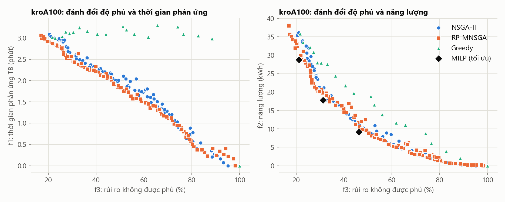
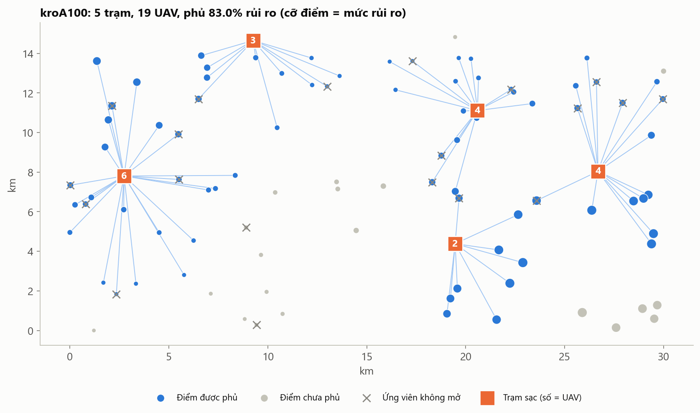

# UAV charging-station placement và fleet sizing

Bài tập nghiên cứu môn học (đề 8, nhóm 8): tối ưu đa mục tiêu vị trí trạm sạc, số UAV
mỗi trạm và vùng phục vụ cho nhiệm vụ ứng phó thiên tai.

## Bài toán

Chọn trạm sạc trong tập vị trí ứng viên, số UAV tại mỗi trạm và phép gán điểm nhu cầu
vào trạm để cùng cực tiểu hóa:

| Mục tiêu | Ý nghĩa |
|---|---|
| f1 | Thời gian phản ứng trung bình có trọng số rủi ro của các điểm được phủ |
| f2 | Năng lượng bay trong một chu kỳ hoạt động |
| f3 | Tỉ lệ rủi ro không được phủ |

Ràng buộc: tầm bay của pin, năng lực đội bay tại từng trạm, sức chứa trạm và ngân sách.

## Thuật toán

- **Greedy**: heuristic tham lam kiểu MCLP có xét năng lực.
- **MILP**: nghiệm tham chiếu trên instance nhỏ (scipy + HiGHS).
- **NSGA-II**: NSGA-II chuẩn với constraint-domination.
- **RP-MNSGA** (đề xuất): NSGA-II lai với mã hóa rút gọn, bộ giải mã ưu tiên rủi ro,
  risk-priority repair, tìm kiếm cục bộ và khởi tạo từ greedy; kèm ba biến thể ablation.

## Cấu trúc

| Đường dẫn | Nội dung |
|---|---|
| `uav_station_fleet.py` | Toàn bộ mô hình, thuật toán, thực nghiệm và vẽ hình |
| `make_report.py` | Sinh báo cáo Word từ kết quả |
| `BaoCao_Nhom8_UAV.docx` | Báo cáo |
| `data/` | 7 instance TSPLIB (eil51, berlin52, kroA100, ch150, pr299, rat575, pr1002) |
| `results/` | Bảng (`table_main.csv`, `summary.json`) và hình |

## Cách chạy

Cần Python 3.10+ với `numpy`, `scipy`, `matplotlib`, `python-docx`.

```bash
python uav_station_fleet.py demo                # chạy nhanh trên kroA100
python uav_station_fleet.py experiment --quick  # bản rút gọn, dưới 1 phút
python uav_station_fleet.py experiment          # toàn bộ thực nghiệm (30 seed)
python uav_station_fleet.py plots               # vẽ lại hình từ results/raw.pkl
python make_report.py                           # sinh BaoCao_Nhom8_UAV.docx
```

Mọi yếu tố ngẫu nhiên đều có seed cố định nên kết quả tái lập được.

## Kết quả chính

Hypervolume trung bình trên 30 seed, 20.000 lần đánh giá mỗi lần chạy (càng lớn càng tốt).
Cột cuối: kết quả kiểm định Wilcoxon rank-sum có hiệu chỉnh Holm giữa RP-MNSGA và NSGA-II.

| Instance | Số điểm | Greedy | NSGA-II | RP-MNSGA | Cải thiện | p (Holm) |
|---|---|---|---|---|---|---|
| eil51 | 51 | 0.4703 | 0.6790 ± 0.0020 | 0.6813 ± 0.0004 | +0.3% | 9.5e-10 |
| berlin52 | 52 | 0.6981 | 0.8968 ± 0.0075 | 0.9001 ± 0.0071 | +0.4% | 9.1e-03 |
| kroA100 | 100 | 0.5614 | 0.7908 ± 0.0147 | 0.8356 ± 0.0021 | +5.7% | 1.2e-10 |
| ch150 | 150 | 0.6558 | 0.9031 ± 0.0209 | 0.9630 ± 0.0059 | +6.6% | 1.2e-10 |
| pr299 | 299 | 0.8194 | 1.0322 ± 0.0130 | 1.0782 ± 0.0076 | +4.5% | 1.2e-10 |
| rat575 | 575 | 0.7951 | 0.9809 ± 0.0099 | 1.0239 ± 0.0096 | +4.4% | 1.2e-10 |

- RP-MNSGA tốt hơn NSGA-II chuẩn có ý nghĩa thống kê trên cả 6 instance.
- Ablation: khởi tạo từ greedy và repair là hai thành phần đóng góp chính; tìm kiếm cục bộ chỉ có ý nghĩa trên 1/6 instance.
- So với MILP trên ba instance nhỏ: độ phủ tốt nhất của RP-MNSGA cách tối ưu không quá 2.1 điểm phần trăm; năng lượng còn cách 0–24% ở hầu hết các mức và tới 73% ở vùng độ phủ thấp của eil51.

Chi tiết đầy đủ (IGD, ablation, độ nhạy, khả năng mở rộng) nằm trong báo cáo và `results/`.





## Hạn chế

- Trọng số rủi ro là dữ liệu tổng hợp; chưa có case study với dữ liệu thực.
- Chưa so sánh với MOEA/D hoặc NSGA-III.
- Khoảng cách Euclid, nhu cầu tĩnh, mỗi chuyến bay phục vụ một điểm.

## Dữ liệu

Tọa độ lấy từ [TSPLIB](http://comopt.ifi.uni-heidelberg.de/software/TSPLIB95/). Trọng số
rủi ro và tần suất nhiệm vụ là dữ liệu tổng hợp sinh với seed cố định; OpenStreetMap và
RescueNet/C2A chưa được tích hợp.
